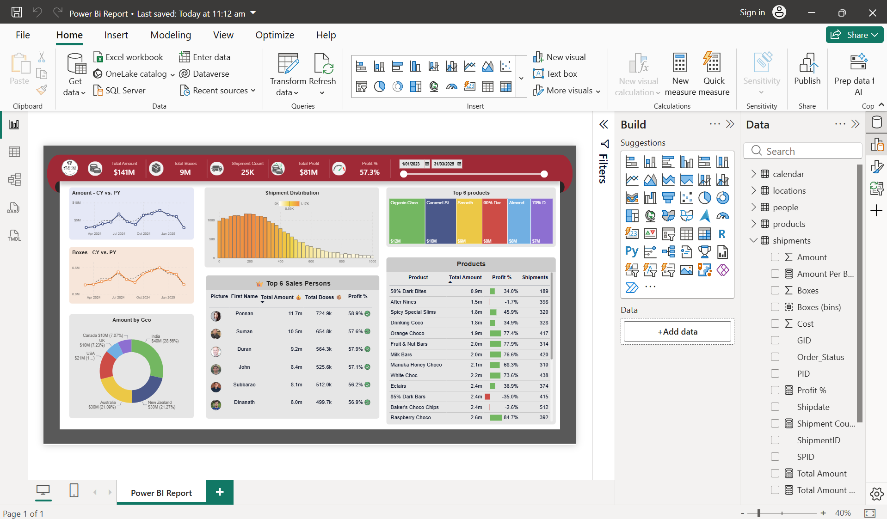

# 🍫 Chocolate Shipments Analysis Dashboard

<p align="center">
  <strong>DATA ANALYTICS • BUSINESS INTELLIGENCE • INTERACTIVE REPORTING</strong>
</p>

<p align="center">
  
  
  
  
</p>

---

## 📌 Project Overview

The **Chocolate Shipments Analysis Dashboard** is an interactive Business Intelligence project developed using Microsoft Power BI. It provides insights into chocolate shipment performance through key performance indicators and interactive visualizations.

The dashboard enables analysis of sales amounts, shipment volumes, profitability, product performance, sales person performance, and geographical distribution.

## 🎯 Project Objectives

- Monitor overall sales and shipment performance.
- Analyze total amount, boxes, shipment count, and profit.
- Evaluate product-wise profitability.
- Compare current-year and previous-year performance.
- Identify top-performing products and sales persons.
- Analyze geographical sales distribution.
- Present business data through an interactive dashboard.

## 🛠️ Tools & Technologies

| Tool | Purpose |
|---|---|
| Microsoft Power BI | Dashboard development and visualization |
| Power Query | Data cleaning and transformation |
| DAX | Measures and business calculations |
| Microsoft Excel | Source dataset |

## 📊 Dashboard Preview

<p align="center">
  
</p>

## 📈 Key Performance Indicators

The dashboard includes the following KPIs:

- **Total Amount** – Overall shipment sales amount.
- **Total Boxes** – Total number of boxes shipped.
- **Shipment Count** – Total number of shipments.
- **Total Profit** – Overall profit generated.
- **Profit Percentage** – Profitability as a percentage of total amount.

## ✨ Dashboard Features

### 1. Sales Performance Analysis

- Current Year vs Previous Year amount comparison.
- Current Year vs Previous Year boxes comparison.
- Monthly performance trends.

### 2. Shipment Distribution

- Shipment volume distribution.
- Visual analysis of shipment frequency.

### 3. Product Performance

- Top 6 products based on total amount.
- Product-wise amount, profit percentage, and shipment analysis.
- Conditional formatting to highlight profitability.

### 4. Sales Person Performance

- Top 6 sales persons based on total amount.
- Sales person-wise amount and boxes.
- Profit percentage comparison.

### 5. Geographical Analysis

- Country-wise amount distribution.
- Geographical contribution to overall sales.

### 6. Interactive Filtering

- Date range slicer.
- Interactive dashboard visuals.
- Dynamic filtering across report elements.

## 📂 Dataset Information

**Dataset Name:** `sample-chocolate-shipments-data-all-Apr-2025.xlsx`

The original Excel dataset is included in the `Dataset` folder of this repository.

## 📁 Repository Structure

```text
Chocolate-Shipments-Analysis-Dashboard/
│
├── Dataset/
│   └── sample-chocolate-shipments-data-all-Apr-2025.xlsx
│
├── Images/
│   ├── Icons/
│   │   ├── amount-1.png
│   │   ├── boxes-1.png
│   │   ├── canceled-orders-1.png
│   │   ├── profit-pct-1.png
│   │   ├── profits-1.png
│   │   └── shipments-1.png
│   │
│   └── Dashboard_Screenshot.png
│
├── PowerBI/
│   └── Chocolate_Shipments_Analysis.pbix
│
└── README.md
```

## 🚀 How to Run the Project

1. Download or clone this repository.
2. Install and open Microsoft Power BI Desktop.
3. Navigate to the `PowerBI` folder.
4. Open `Chocolate_Shipments_Analysis.pbix`.
5. If prompted, update the Excel dataset source path in Power Query.
6. Refresh the data to explore the dashboard.

## 📥 Project Resources

| Resource | Link |
|---|---|
| Power BI Dashboard | [View / Download PBIX](PowerBI/Chocolate_Shipments_Analysis.pbix) |
| Raw Dataset | [View / Download Dataset](Dataset/sample-chocolate-shipments-data-all-Apr-2025.xlsx) |
| Dashboard Preview | [View Dashboard Image](Images/Dashboard_Screenshot.png) |

**Note:** Download the Power BI file and open it using Microsoft Power BI Desktop. If prompted, update the dataset source path and refresh the data to explore the interactive dashboard.

## 💡 Skills Demonstrated

- Data Analysis
- Data Cleaning and Transformation
- Power Query
- Data Modelling
- DAX Measures
- Power BI Dashboard Development
- Data Visualization
- KPI Development
- Interactive Reporting
- Business Performance Analysis

## 👨‍💻 About the Author

**Yogeswar Reddy**

B.Tech in Computer Science and Engineering

Aspiring Data Analyst | Python | SQL | Excel | Power BI

[](https://github.com/YogiReddy7396)

---

<p align="center">
  <strong>Developed as part of my Data Analytics learning journey.</strong>
</p>
